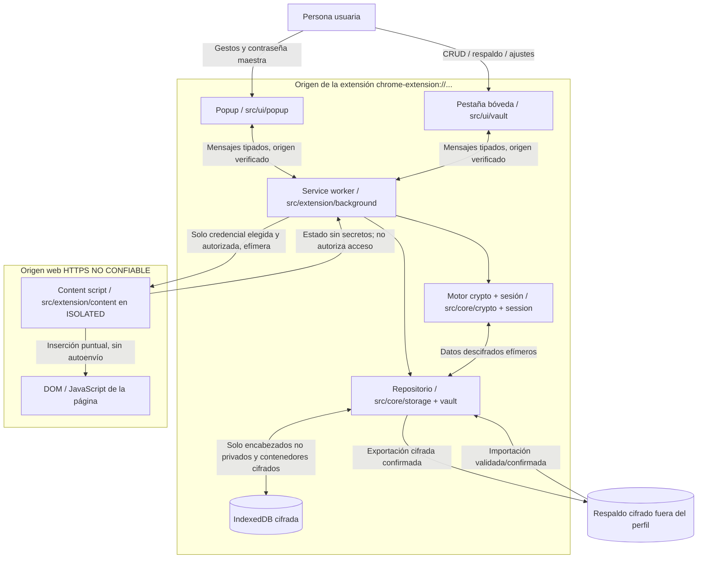
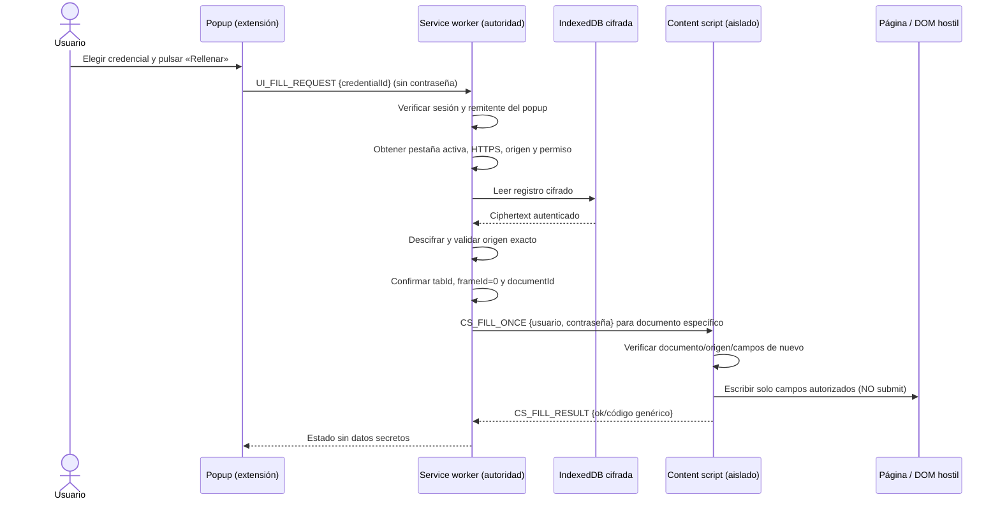

# AegisVault — Arquitectura, mensajes y límites de confianza v1.0

| Campo | Valor |
| --- | --- |
| Proyecto | AegisVault |
| Punto del roadmap | **AV-004** |
| Documento | `docs/architecture.md` |
| Estado | **Diseño propuesto para aceptación; no implementado ni auditado** |
| Plataforma | Chrome y Brave, extensiones Chromium Manifest V3 |
| Dependencias de diseño | [Alcance AV-001](scope.md), [amenazas AV-002](security/threat-model.md), [principios AV-003](security/principles.md), [política](../SECURITY.md) |
| Decisión vinculada | [ADR-001](decisions/ADR-001.md) |

> **Aviso obligatorio:** solo se utilizarán cuentas y contraseñas ficticias hasta completar pruebas y revisión independiente. Las garantías descritas son **objetivos de diseño**, no controles ya verificados. Una extensión no protege plenamente frente a malware local, navegador comprometido u otras extensiones capaces de observar el DOM.

## 1. Objetivo y límites

Definir (1) componentes y dependencias, (2) superficies que pueden recibir texto claro, (3) fronteras de confianza y (4) contratos de mensajes que permitirán construir el MVP sin que un sitio web obtenga facultades para consultar la bóveda.

**Incluido:** bóveda por perfil de navegador, uso local sin red iniciada por la extensión, IndexedDB cifrada, creación/desbloqueo/bloqueo, CRUD, búsqueda local tras desbloqueo, generador, copia deliberada, rellenado manual en documentos principales HTTPS, respaldo/restauración cifrada.

**Excluido:** servidor, sincronización, móvil, Firefox como destino v1.0, TOTP, passkeys, guardado automático, envío automático de formularios, relleno silencioso y `iframes`. No se incorporarán permisos globales persistentes para operar en todas las páginas.

**Aclaración:** el `service worker` es un **lugar de ejecución privilegiado mientras vive**, no un proceso permanente. Chrome puede terminarlo por inactividad y sus variables desaparecen; por ello, **un worker nuevo siempre inicia BLOQUEADO**. Esta es una decisión concreta de [ADR-001](decisions/ADR-001.md) y se revisará en AV-029 solo mediante nuevo ADR si se quisiera prolongar la sesión.

## 2. Diagrama de componentes



**Interpretación de flechas:** muestran comunicación lógica, **no** permisos automáticos. El motor criptográfico es un **módulo importado y ejecutado dentro del service worker**, no un proceso separado con aislamiento del sistema operativo. IndexedDB pertenece al origen de la extensión y los contextos de extensión podrían técnicamente abrirla; **la restricción de acceso exclusivo al repositorio es una norma de implementación y revisión de código, no una ACL impuesta por Chrome**.

### 2.1 Diagrama de secuencia del relleno manual



Si entre selección y entrega cambia la pestaña, el documento o el origen, la operación **se cancela**. Si un navegador objetivo carece de una identificación documental fiable, no degradaremos a una entrega amplia a todos los frames: la compatibilidad deberá revisarse en AV-009/AV-048–051. Un resultado `ok` no prueba que la página no haya leído o alterado la contraseña después de insertarla.

## 3. Inventario y responsabilidades de componentes

| ID | Componente / ruta prevista | Responsabilidades | Datos que **puede** tratar | Lo que **no puede** hacer |
| --- | --- | --- | --- | --- |
| C-01 | Popup `src/ui/popup/` | Entrada de desbloqueo, selección de cuenta, acción expresa de relleno, notificaciones | Contraseña maestra **solo durante entrada**; listas y credenciales descifradas **solo si una acción de UI concreta lo requiere** | Almacenar KEK/DEK; descifrar directamente; leer IndexedDB; enviar mensajes con secreto a páginas |
| C-02 | Pestaña bóveda `src/ui/vault/` | CRUD, búsqueda, generación, pantalla de importación/exportación y confirmaciones | Datos de registros solicitados en la UI desbloqueada y contraseña maestra solo para cambio/desbloqueo | Ser depositaria persistente de claves, consultar IndexedDB directamente o conservar contraseñas en `localStorage`/`sessionStorage` |
| C-03 | Service worker `src/extension/background/` | **Autoridad central:** validación de mensajes, sesiones, permisos, coincidencia de origen, operaciones y relleno | Contraseña maestra **transitoria** al crear/desbloquear; KEK durante derivación; DEK de sesión; texto claro solo al operar | Ser tratado como proceso permanente; persistir DEK o master en claro; aceptar operaciones secretas desde scripts de página |
| C-04 | Crypto `src/core/crypto/` | Argon2id, cifrado autenticado, generación aleatoria, envoltura de DEK | KEK/DEK y datos descifrados en el contexto donde se importa (en v1.0, **solo C-03**) | Algoritmos caseros; reutilizar IV; código remoto; registrar secretos |
| C-05 | Sesión `src/core/session/` | Estado `LOCKED/UNLOCKED`, vencimiento, invalidación y comprobación por operación | Referencia en memoria a DEK no exportable cuando sea viable | Guardar material de desbloqueo sin protección en `chrome.storage.*`, IndexedDB o UI |
| C-06 | Repositorio `src/core/storage/` y `src/core/vault/` | Transacciones, versiones, lectura/escritura de registros cifrados y respaldos | Encabezados mínimos y ciphertext; texto claro temporalmente en lógica de vault dentro del worker | Índices con títulos/dominios/usuarios en claro; migraciones destructivas no confirmadas |
| C-07 | IndexedDB | Persistencia local de cabecera, DEK **envuelta** y registros cifrados | **Solo ciphertext** y metadatos técnicos mínimos justificados | Contener contraseñas maestras, KEK/DEK en claro, nombres, URLs o usuarios legibles |
| C-08 | Content script `src/extension/content/` | Detectar campos y **aplicar una sola operación de relleno autorizada** | Username/password **únicamente durante el relleno actual**; DOM y metadatos no confiables | Recibir claves, lista de toda la bóveda, búsqueda, desbloqueo, realizar submit, guardar datos o ejecutar en `MAIN` |
| C-09 | DOM web | Formulario receptor controlado por el sitio | **Podrá ver lo rellenado**; es una consecuencia inevitable | No adquiere permisos de extensión por recibir un campo |
| C-10 | Archivo de respaldo | Portabilidad y recuperación fuera de la extensión | Contenedor cifrado y autenticado | Contener exportación ordinaria en claro |

**Distinción crítica:** *«sin secretos persistentes en componentes de página»* no significa *«el content script jamás ve una contraseña»*: debe recibir temporalmente la contraseña seleccionada para escribirla en el campo. La página puede inspeccionar esa contraseña inmediatamente. Lo prohibido es entregar **la contraseña maestra, KEK, DEK, otras credenciales o un listado completo**, o conservar secretos tras la operación.

## 4. Clasificación del material sensible por zona

| Material | Popup / pestaña extensión | Service worker | Content script | DOM sitio web | IndexedDB |
| --- | --- | --- | --- | --- | --- |
| Contraseña maestra | **Entrada efímera exclusivamente** para crear/desbloquear/cambiar | **Efímera** durante KDF | **Nunca** | **Nunca** | **Nunca** |
| KEK derivada | Nunca | Solo durante desbloqueo/envoltura | Nunca | Nunca | Nunca en claro |
| DEK descifrada | Nunca | Solo mientras sesión esté desbloqueada y worker vivo | Nunca | Nunca | Nunca en claro; sí DEK envuelta |
| Título / sitio / usuario de una cuenta | Solo con sesión y operación aprobada | Al consultar, con sesión | Usuario de **una** cuenta al rellenar | Usuario insertado, si lo requiere | Solo cifrado |
| Contraseña guardada | Solo mostrar/copiar cuando la persona lo solicite expresamente | Solo con sesión y operación aprobada | **Una** contraseña y por tiempo mínimo, al rellenar | Contraseña rellenada y visible para el sitio | Solo cifrada |
| Inventario completo de credenciales | Puede renderizar datos de listados para operación autorizada | Permite consultas y filtra | Nunca | Nunca | Solo cifrado |
| Estado de sesión | Indicador `LOCKED/UNLOCKED` no vinculante | **Fuente de verdad en memoria** | No confiable para autorización | No | No |

No se promete borrado físico de cadenas en memoria JavaScript: el recolector de basura, copias internas del navegador y memoria del SO están fuera del control directo de la aplicación. Minimizar duración y referencias sigue siendo obligatorio.

## 5. Fronteras de confianza (TB) y contrato verificable

Se mantienen los identificadores TB-01 a TB-09 de AV-002. Cada cruce tendrá reglas explícitas:

| Frontera | Control propuesto | Acción obligatoria al fallar |
| --- | --- | --- |
| **TB-01** Persona → interfaz | Captura de master solo en `chrome-extension://`; indicación de riesgo/recuperación | Rechazar contexto no confiable, no persistir entrada |
| **TB-02** UI → worker | Verificar `sender.id`, `sender.url` de página interna permitida, tipo, esquema, tamaño de mensaje y sesión por operación | `ERR_FORBIDDEN` sin información sensible |
| **TB-03** Worker ↔ almacenamiento | Cifrado antes de persistir, AEAD, transacciones y validación de formato | Rechazo sin devolver texto parcial y sin escrituras destructivas |
| **TB-04** Worker → content script | Solo `CS_FILL_ONCE` tras gesto de popup y control sobre origen/documento/frame principal | No entregar credencial |
| **TB-05** Content script ↔ DOM | Mundo `ISOLATED`, validación de campos, rechazo de frame/HTTP, no submit, no `postMessage` de secretos | Responder error genérico y no rellenar |
| **TB-06** Bóveda ↔ respaldo | Exportar cifrado; validar límites, versión, autenticidad, consentimiento y restauración atómica | No sobreescribir bóveda existente |
| **TB-07** Contraseña → clipboard | Solo acción explícita, aviso de riesgo | No copiar inadvertidamente; no prometer limpieza global |
| **TB-08** Dependencias/CI → extensión | Paquetes locales fijados, CSP, revisión y compilación reproducible | No publicar artefacto inseguro |
| **TB-09** Sesión → ciclo MV3 | Worker nuevo = `LOCKED`; no claves en `storage.session`/`storage.local` | Requerir contraseña maestra otra vez |

**Límites adicionales:** una página de extensión y el worker comparten origen; la validación de remitente evita errores de enrutamiento, pero **no** es una barrera contra una XSS que ejecute código dentro de nuestra propia UI. CSP, sanitización y revisión del código son controles indispensables. Una extensión externa con permisos o un navegador comprometido pueden superar protecciones de la aplicación.

## 6. Contrato de mensajería v1 (lógico; se implementará en AV-011/AV-049)

### 6.1 Sobre de mensaje obligatorio

```ts
// Especificación, NO código implementado.
type Request<T extends string, P> = {
  protocol: 'aegisvault/v1';
  requestId: string;       // identificador de correlación, NO token de sesión
  type: T;
  payload: P;
};
type Result<T> =
  | { protocol: 'aegisvault/v1'; requestId: string; ok: true; data: T }
  | { protocol: 'aegisvault/v1'; requestId: string; ok: false; error: ErrorCode };
type ErrorCode =
  | 'ERR_LOCKED' | 'ERR_FORBIDDEN' | 'ERR_INVALID_REQUEST'
  | 'ERR_ORIGIN_MISMATCH' | 'ERR_DOCUMENT_CHANGED'
  | 'ERR_UNSUPPORTED_CONTEXT' | 'ERR_EXPIRED' | 'ERR_STORAGE'
  | 'ERR_INVALID_CIPHERTEXT' | 'ERR_INTERNAL';
```

**Requisitos de transporte:** validar esquema y límites de longitud/volumen; rechazar propiedades inesperadas para mensajes sensibles; no enviar `Error.message`, stacks, claves ni objetos completos de credencial a content scripts; no colocar secretos en `requestId`, URL o logs; no serializar objetos arbitrarios suministrados por el DOM. `requestId` correlaciona respuestas pero **no autoriza** una operación. Las validaciones se hacen del lado del worker, no únicamente en el popup.

### 6.2 Matriz de operaciones permitidas

| Emisor verificado | Tipo de solicitud / destino | Datos de solicitud | Respuesta legítima | Autorización |
| --- | --- | --- | --- | --- |
| Popup / bóveda | `UI_SESSION_STATUS` → worker | Ningún secreto | `{locked: boolean}` | Solo origen de extensión autorizado |
| Popup / bóveda | `UI_VAULT_CREATE` → worker | Master efímera + parámetros validados | `{created:true}` sin claves | Sin bóveda previa; confirmación UI |
| Popup / bóveda | `UI_VAULT_UNLOCK` → worker | Master efímera | `{unlocked:true}` sin clave | Bóveda existente; rate-limits locales por decidir AV-028 |
| Popup / bóveda | `UI_VAULT_LOCK` → worker | Ninguno | Estado | Cualquier sesión UI permitida |
| Popup / bóveda | `UI_CREDENTIAL_LIST` / `UI_CREDENTIAL_GET` → worker | Filtros / ID | Campos necesarios para UI, no claves | Sesión desbloqueada; solo página extensión |
| Popup / bóveda | `UI_CREDENTIAL_SAVE` / `UI_CREDENTIAL_DELETE` → worker | Registro/ID y confirmación de UI | ID/estado | Sesión desbloqueada, validación de campos |
| Popup / bóveda | `UI_GENERATE_PASSWORD` → worker | Longitud y alfabeto | Contraseña a UI solicitante | Solo extensión; gesto explícito para copiar |
| Popup | `UI_FILL_REQUEST` → worker | **Solo** `credentialId`; nunca `tabId`, URL arbitraria ni contraseña | `{filled: boolean}` o error | Sesión, gesto, pestaña activa, permiso, HTTPS, coincidencia exacta |
| Popup / bóveda | `UI_BACKUP_EXPORT` / `UI_BACKUP_IMPORT` → worker | Confirmación o contenedor cifrado validado | Resultado / bytes cifrados | Sesión y flujo confirmado; límites de tamaño |
| Content script | `CS_FORM_STATUS` → worker | Descriptores mínimos de campos, sin valores | Estado no sensible, si hace falta | No da permisos ni inicia relleno |
| Worker | `CS_FILL_ONCE` → content script | **Solo un** usuario y contraseña elegidos + contexto vinculado | `CS_FILL_RESULT`: éxito/error genérico | Mensaje dirigido a `tabId`, `frameId=0`, `documentId`; operación aprobada en UI |
| Página web / extensión externa | **Ninguna** operación | — | **Sin API externa** | No registrar `onMessageExternal` / `onConnectExternal` en v1.0 |

**Puntos que deberán precisarse durante implementación:** la prueba técnica de gesto de usuario en popup, mecanismos de protección contra reentrada/doble clic, tamaños máximos de solicitudes y elección de API de archivos. El contrato **prohíbe** que un mensaje `CS_FORM_STATUS` solicite texto claro, claves o el ID de una credencial para obtener su contraseña.

### 6.3 Validación de remitentes

1. **Mensajes de UI:** comprobar que provienen de un documento empaquetado de la extensión (URL completa permitida, `sender.id === chrome.runtime.id`) y de un contexto compatible; verificar sesión y autorización de cada operación. No confiar en un campo `source: 'popup'` enviado por el cliente.
2. **Mensajes de content script:** tratar como no confiables incluso si `sender.id` corresponde a nuestra extensión; cuando se utilicen, inspeccionar `sender.tab.id`, `sender.frameId`, `sender.documentId`, `sender.origin`/`sender.url` y tipo de acción. Una etiqueta de origen declarada en `payload` nunca sustituye estos metadatos.
3. **Respuestas worker → script:** enviar solo a la pestaña, al **frame 0** y al `documentId` que correspondan al permiso actual; comprobar disponibilidad de la API en la versión mínima probada; la confirmación de entrega **no garantiza** ausencia de carreras de navegación, por eso el script verifica `location.origin` nuevamente.
4. Rechazar por defecto: mensaje desconocido, protocolo distinto, request caducada, worker reiniciado, frame distinto, `about:`, `file:`, `chrome:`, `chrome-extension:` del sitio destino, HTTP, incógnito sin revisión, perfiles no autorizados y dominios parecidos.

## 7. Flujo de claves y estados de sesión

### 7.1 Creación

```text
[Master temporal en UI] --mensaje interno--> [worker]
    --Argon2id--> [KEK temporal]
    [CSPRNG] --> [DEK aleatoria]
    [KEK] --protege--> [DEK envuelta]
    [IndexedDB] <-- {versión, salt, parámetros, IV, DEK envuelta, ciphertext}
```

Solo los metadatos criptográficos estrictamente necesarios se guardan sin cifrar. Los detalles de AEAD, encabezados autenticados, estructura de claves y parámetros Argon2id **no** se improvisan aquí: se decidirán y comprobarán en AV-012–019. La contraseña maestra no se guarda. La KEK debe ser efímera; la DEK deberá ser, cuando sea viable, un `CryptoKey` no exportable durante la sesión del worker.

### 7.2 Estado y reinicios

```text
NO_VAULT --crear válido--> LOCKED
LOCKED   --desbloquear válido--> UNLOCKED (solo en memoria worker)
UNLOCKED --bloqueo manual / expiración / error crítico--> LOCKED
UNLOCKED --terminación/reinicio worker--> LOCKED
LOCKED   --reinicio worker--> LOCKED
```

- **Fuente de verdad:** estado y referencia a DEK del worker actual. Un popup no podrá afirmar que sigue desbloqueado por un valor cacheado.
- **Worker suspendido:** al reactivarse no rehidratará una DEK desde `chrome.storage.session`, ni desde disco. El usuario deberá volver a introducir master.
- **Operaciones en curso:** si el worker termina a mitad de acción, la UI mostrará error y volverá a comprobar estado; operaciones de base de datos deben ser transaccionales e idempotentes cuando corresponda. No se confirmará una escritura que no se completó.
- **Tiempo de expiración:** se concretará en AV-029/031. El tiempo de vida real del worker puede ser **menor** que el timeout deseado: se bloquea antes y eso es seguro, aunque incómodo.
- **Precisión:** terminar un worker elimina sus referencias administradas, pero **no demuestra** borrado físico inmediato de claves en RAM; no prometer limpieza total ante malware o volcados de memoria.

**Coste UX aceptado para el MVP:** será necesario desbloquear de nuevo con frecuencia si Chrome cierra el worker tras inactividad. Se registrará como limitación visible y se decidirá su evolución con pruebas de AV-029. No se utilizarán alarmas, conexiones ficticias o *keep-alive* artificial para ocultarla.

## 8. Flujo de autorización de relleno (requisitos obligatorios)

1. El usuario abre explícitamente el popup y elige una credencial; la interfaz muestra el origen al que pretende entregarla.
2. El popup emite `UI_FILL_REQUEST` con **solo** el identificador de credencial. El worker determina la pestaña activa real; **no** confía en un destino proporcionado por una página ni por un content script.
3. El worker exige estado `UNLOCKED`, permiso temporal (`activeTab`) u otro permiso **concedido específicamente**, esquema HTTPS y origen exacto (`scheme + hostname + puerto efectivo`) igual al origen aprobado en la credencial. No se aceptan sufijos de dominio, subdominios ni HTTP por defecto.
4. El worker identifica **documento principal**, `frameId=0` y `documentId` actual; si cambian o faltan datos necesarios, deniega. Se previene doble envío y caducan autorizaciones pendientes; no se genera una capacidad reusable accesible desde content scripts.
5. Solo después de validar, el worker descifra el registro y envía los dos valores indispensables al content script del documento vinculado. No manda notas, otros registros, master, KEK ni DEK.
6. Content script en mundo `ISOLATED`: comprueba otra vez HTTPS/origen/documento principal y que los campos esperados existan y sean aptos; no rellena en `iframes`. No registra valores, no los pasa por eventos personalizados ni `window.postMessage`, y no llama a `form.submit()`/`requestSubmit()` ni simula clic en «Ingresar».
7. Tras insertar, devuelve solo éxito/error genérico. La página puede leer los valores ya insertados. **El nombre del host no demuestra que el sitio esté libre de ataques**; el usuario sigue siendo responsable de confiar en él.

**Ataques que reducen las validaciones:** phishing por dominio parecido, entrega a `iframe`, órdenes de content scripts no autorizadas, navegación entre selección y relleno. **No eliminan:** DOM malicioso en origen legítimo, extensiones externas que observen el formulario, malware, XSS del sitio o filtración por portapapeles.

## 9. Persistencia y exportación

- La única fuente persistente de datos privados es **IndexedDB con registros cifrados autenticados**, más DEK envuelta y encabezados técnicos mínimos. No duplicar datos en `chrome.storage.local`, `chrome.storage.sync`, `localStorage`, archivos de logs ni `storage.session`.
- La búsqueda se ejecuta **tras desbloquear**, descifrando en el worker según necesite; no habrá índice persistente con URL/título/usuario en claro.
- Los respaldos salen en formato cifrado/autenticado y se validan con límites de tamaño, versión, integridad y confirmación previa a restaurar. La importación fallida deja intacta la base existente.
- El archivo cifrado fuera del perfil se considera bajo custodia del usuario; quien lo robe podrá intentar adivinar la master offline. AES-GCM no impide por sí solo sustituir todo el archivo por una versión antigua válida (rollback).
- Para evitar confundir permisos, **no** usaremos `chrome.storage.sync`, ninguna API de red ni servicios externos en el MVP.

## 10. Estructura futura (propuesta, no archivos creados)

```text
AegisVault/
├── README.md
├── SECURITY.md
├── docs/
│   ├── scope.md
│   ├── architecture.md                  # AV-004
│   ├── decisions/
│   │   └── ADR-001.md                   # AV-004
│   └── security/
│       ├── threat-model.md
│       └── principles.md
├── public/
│   └── manifest.json                    # AV-009
├── src/
│   ├── extension/
│   │   ├── background/                  # autoridad MV3
│   │   └── content/                     # DOM no confiable
│   ├── core/
│   │   ├── crypto/                       # importado solo desde background
│   │   ├── session/
│   │   ├── storage/
│   │   ├── vault/
│   │   └── backup/
│   ├── ui/
│   │   ├── popup/
│   │   └── vault/
│   └── shared/
│       └── contracts/                   # tipos, schemas, errores no sensibles
└── tests/
    ├── security/
    ├── integration/
    └── e2e/
```

Los nombres son orientativos y se concretarán en AV-008. **Que aparezca un archivo en el esquema no significa que ya exista ni que se haya implementado.**

## 11. Matriz de trazabilidad: requisitos → arquitectura → pruebas futuras

| Requisito / política | Regla arquitectónica | Prueba futura (no ejecutada) | Roadmap |
| --- | --- | --- | --- |
| RF-001/002, RNF-003 | Master solo UI→worker, KDF en worker | Master no aparece en DB; master errónea no abre | AV-012–018, AV-025–028 |
| RF-003/004, RNF-008, POL-15 | DEK solo memoria worker; reinicio = LOCKED | Terminar worker y solicitar lista/copia/fill → denegar | AV-029–031, AV-064 |
| RF-005–009, RNF-001 | Bóveda cifrada, CRUD en worker, sin índice sensible en claro | Inspección de IndexedDB tras CRUD y búsqueda | AV-019–024, AV-032–038 |
| RF-012–014, RNF-004/007, POL-08–10/21 | Autorización de popup; coincidencia exacta, frame 0, documento fijo | Dominio falso, navegación y iframe → rechazo | AV-044–051, AV-065 |
| RF-015/016, RNF-006/010, POL-14 | Respaldo autenticado; importación atómica | Corrupción → sin cambios; recuperación limpia | AV-058–062, AV-068 |
| RNF-005, POL-03/12 | Sin API propia de red/código remoto | Monitor de tráfico, bundle offline | AV-067/072 |
| RNF-011, POL-17/19/23 | Declarar límites, revisión independiente | Informe de hallazgos antes de declarar listo | AV-069–073 |
| POL-13 | Errores no sensibles, sin logs de credenciales | Inspección de logs y mensajes forzando errores | AV-063–067 |

## 12. Checklist de cierre documental AV-004

- [x] Diagrama de componentes con popup, pestaña bóveda, worker, crypto, IndexedDB y content script.
- [x] Secuencia de relleno manual desde el gesto hasta el DOM.
- [x] Matriz explícita de qué contexto puede ver master, KEK, DEK y credenciales.
- [x] Fronteras TB-01..TB-09 y políticas de rechazo al fallar.
- [x] Contrato de mensajes y validación de remitentes/origen/documento.
- [x] Diseño **fail-closed** ante suspensión de worker documentado en ADR-001.
- [x] Sin persistencia prevista de secretos en content script, DOM propio de página ni almacenes en claro.
- [x] Exclusiones y rastreo con AV-001/002/003.
- [ ] Revisión y aceptación del responsable del proyecto.
- [ ] Integración efectiva al repositorio.
- [ ] Pruebas de ejecución (se harán cuando exista código, **no** en AV-004).

## 13. Referencias técnicas oficiales

1. [Chrome — Extension service worker lifecycle](https://developer.chrome.com/docs/extensions/develop/concepts/service-workers/lifecycle) — suspensión del worker y pérdida de globals.
2. [Chrome — Message passing](https://developer.chrome.com/docs/extensions/develop/concepts/messaging) — mensajería y riesgos de content scripts.
3. [Chrome — Stay secure](https://developer.chrome.com/docs/extensions/develop/security-privacy/stay-secure) — controles de XSS, límites de confianza y validación.
4. [Chrome — Content scripts](https://developer.chrome.com/docs/extensions/reference/manifest/content-scripts) — mundo `ISOLATED` y riesgo de `MAIN`.
5. [Chrome — Runtime API, MessageSender](https://developer.chrome.com/docs/extensions/reference/api/runtime) — `tab`, `frameId`, `documentId`, `origin`, `url`.
6. [Chrome — Tabs API](https://developer.chrome.com/docs/extensions/reference/api/tabs) — mensajes dirigidos a `documentId` y `frameId`.
7. [Chrome — Protect user privacy](https://developer.chrome.com/docs/extensions/develop/security-privacy/user-privacy) — `activeTab` y permisos mínimos.
8. [Chrome — Storage API](https://developer.chrome.com/docs/extensions/reference/api/storage) — áreas y exposición de storage.
9. [Chrome — Storage and cookies](https://developer.chrome.com/docs/extensions/develop/concepts/storage-and-cookies) — IndexedDB y contextos de extensión.
10. [OWASP — Cryptographic Storage Cheat Sheet](https://cheatsheetseries.owasp.org/cheatsheets/Cryptographic_Storage_Cheat_Sheet.html) — claves KEK/DEK, AEAD y almacenamiento.

---
