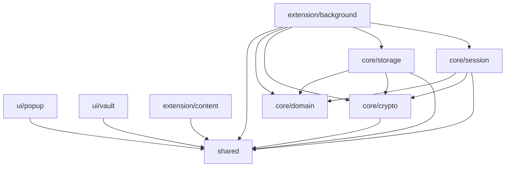

# AV-008 — Organización modular y reglas de importación

**Estado:** propuesta implementable para revisión; sin código de gestión de credenciales todavía.
**Contrato superior:** [Arquitectura AV-004](../architecture.md) y [ADR-001](../decisions/ADR-001.md).
**Roadmap:** [AV-008](../../ROADMAP.md). **Seguridad:** [SECURITY.md](../../SECURITY.md).

## 1. Objetivo y límite

Definir directorios reales y una regla ejecutable para que ningún componente con acceso al navegador o a la interfaz penetre en el núcleo del dominio. AV-008 **no** crea la bóveda, no instala la extensión ni almacena secretos. El *service worker* será la autoridad criptográfica en fases posteriores, según ADR-001.

La compilación de AV-007 (`src/tooling/smoke.ts`) sigue siendo el único bundle temporal. No cambiaremos `public/manifest.json`, ni implementaremos contenido de `background`, `content`, `popup` o `vault` antes de AV-009/010.

## 2. Estructura versionada

```text
src/
  core/
    crypto/       # Cifrado, derivación, AEAD; sin chrome ni DOM
    domain/       # Entidades/reglas de negocio, puras, sin IndexedDB
    storage/      # Adaptadores de persistencia; IndexedDB solo aquí o infraestructura autorizada
    session/      # Estado temporal del worker y vencimiento de sesión
  extension/
    background/   # Autoridad worker, permisos, validación de mensajes
    content/      # Adaptador DOM no confiable; relleno individual autorizado
  ui/
    popup/        # Pantalla popup, solicitudes a worker
    vault/        # Pestaña de gestión, solicitudes a worker
  shared/         # DTOs y tipos de mensajes puros; jamás secretos persistidos
  tooling/        # Prueba de compilación AV-007, se retirará al sustituir build
scripts/
  check-boundaries.mjs
  verify-build.mjs
tests/
  architecture/check-boundaries.test.mjs
```

Los archivos `.gitkeep` únicamente aseguran que Git registre directorios sin implementaciones prematuras.

## 3. Matriz de dependencias permitidas

Una fila puede importar únicamente sus capas listadas (y a sí misma):

| Desde | Puede importar | Prohibido destacado |
| --- | --- | --- |
| `core/domain` | `core/domain` | `shared`, `crypto`, `storage`, `session`, UI, DOM, extensión, npm |
| `shared` | `shared` | Todo lo demás, npm y browser/Node APIs |
| `core/crypto` | `core/crypto`, `shared` | UI, content, background, DOM/Chrome, Node |
| `core/storage` | `core/storage`, `core/domain`, `core/crypto`, `shared` | UI y extensión |
| `core/session` | `core/session`, `core/domain`, `core/crypto`, `shared` | UI y extensión |
| `extension/background` | `extension/background`, `core/*`, `shared` | UI, content (importación directa) |
| `extension/content` | `extension/content`, `shared` | `crypto`, `storage`, `session`, dominio, background, UI |
| `ui/popup` | `ui/popup`, `shared` | Acceso directo al núcleo o content |
| `ui/vault` | `ui/vault`, `shared` | Acceso directo al núcleo o content |
| `tooling` | `tooling`, `shared` | Componentes de producción |

**Importante:** `storage` podrá usar IndexedDB en AV-019–024; esto no significa que `domain` pueda importarlo. `crypto` podrá usar Web Crypto y una dependencia criptográfica revisada en fases futuras; no APIs de pestañas ni DOM. Las interfaces pueden recibir datos puntuales del worker mediante contratos de mensajes definidos en `shared`, nunca importar directamente componentes criptográficos.



Las flechas son dependencias de código permitidas; **no** representan canales de comunicación en tiempo de ejecución ni privilegios reales del navegador.

## 4. Contrato de implementación

1. Los imports internos de `src/` son **relativos**. No se permiten alias `@/`, `src/` ni `@aegisvault/` hasta registrar su resolución en el verificador.
2. El script `scripts/check-boundaries.mjs` analiza archivos JS/TS y rechaza imports estáticos, reexportaciones, `import type`, `import()`, `require()` y rutas que crucen capas sin autorización.
3. `import(variable)` y `require(variable)` se rechazan: no se puede determinar su destino estáticamente.
4. Las URL de código remoto (`https:`, `data:`, `blob:`) también se rechazan por política de extensión sin red propia. Los módulos estándar de Node (`node:fs`, `fs`, etc.) se prohíben en **todo** `src`, ya que ese código está destinado al navegador. Los scripts de `scripts/` sí pueden usar Node.
5. `core/domain` y `shared` no admiten dependencias de paquetes npm externos, ni acceso directo a globales del navegador. `core/crypto` tampoco debe usar DOM, pestañas o APIs de extensión.
6. `extension/content` solo puede importar su propia capa y `shared`; no maneja claves, consulta bóveda ni importa servicios de dominio. Para el relleno futuro, recibirá exclusivamente una credencial autorizada por mensaje.
7. Las UI se comunican por mensajería con la autoridad; no importan servicios o repositorios directamente.
8. Un import interno inválido deberá fallar en `npm run arch:check` y en `npm run check` antes de un commit.
9. Se comprueba **el contenido**, no solo el nombre de archivo o la ruta. Los comentarios de documentación y las pruebas ficticias no requieren importar componentes reales.
10. Las ampliaciones de la matriz o alias necesitan justificación y, si cambian fronteras de confianza, ADR nuevo; no se debilita el verificador para hacer pasar código inválido.

## 5. Validación y pruebas negativas

Desde la raíz:

```bash
npm ci
npm run arch:check
npm run test:architecture
npm run check
npm audit
```

Las pruebas de arquitectura contienen casos permitidos y escenarios que **deben rechazarse** (DOM en dominio, tipos importados desde content, imports dinámicos, acceso fuera de `src`, código Node en el navegador). `npm run check` también conserva ESLint, formato, TypeScript, Vite y el verificador AV-007.

**Prueba manual negativa sin archivos permanentes (opcional):** crea temporalmente `src/core/domain/forbidden.ts` con `import '../../extension/content/x';`, ejecuta `npm run arch:check` y elimina el archivo. El verificador debe devolver código distinto de cero. Nunca realices commit de esa prueba.

## 6. Límites de la garantía

- Es una **regla de arquitectura sobre imports y símbolos detectables**, no una auditoría de seguridad ni un aislamiento de procesos. Código futuro podría intentar eludir un verificador estático (por ejemplo, evaluación indirecta); deben mantenerse revisiones de código y pruebas de seguridad posteriores.
- TypeScript permite tipos de DOM por la configuración base de AV-007; las reglas del analizador y ESLint bloquean uso evidente en capas puras, pero no sustituyen una configuración aislada de tipos ni una revisión manual.
- El acceso a IndexedDB y a mensajes se permitirá solo a los módulos autorizados por política; las rutas de importación por sí solas **no imponen una ACL del navegador**.
- No alterar `ROADMAP.md` para cerrar AV-007/008 hasta tener evidencia real de merge, pruebas y aceptación.

## 7. Aceptación AV-008

- [ ] Nueve directorios funcionales y `tests/architecture` aparecen en Git.
- [ ] Matriz de importaciones revisada y aceptada.
- [ ] `npm run arch:check` informa cero infracciones.
- [ ] `npm run test:architecture` ejecuta casos positivos y negativos exitosamente.
- [ ] `npm run check` pasa sin alterar el bundle AV-007.
- [ ] Sin cambios en `public/manifest.json` ni secretos reales.
- [ ] Commit con `Refs: AV-008`, Git limpio y aceptación del mantenedor.

### Referencias técnicas

- [ESLint — no-restricted-imports](https://eslint.org/docs/latest/rules/no-restricted-imports)
- [ESLint — Configuración moderna](https://eslint.org/docs/latest/use/configure/configuration-files)
- [TypeScript — Compiler API](https://github.com/microsoft/TypeScript/wiki/Using-the-Compiler-API)
- [Node.js — test runner](https://nodejs.org/api/test.html)
